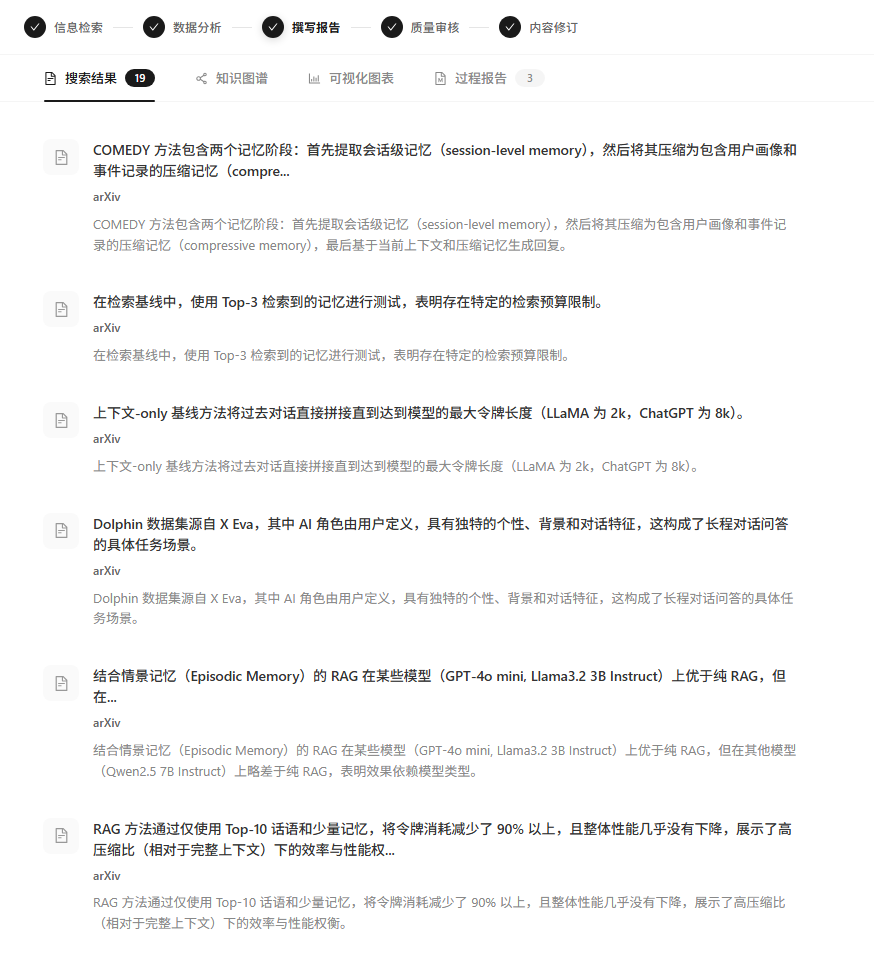
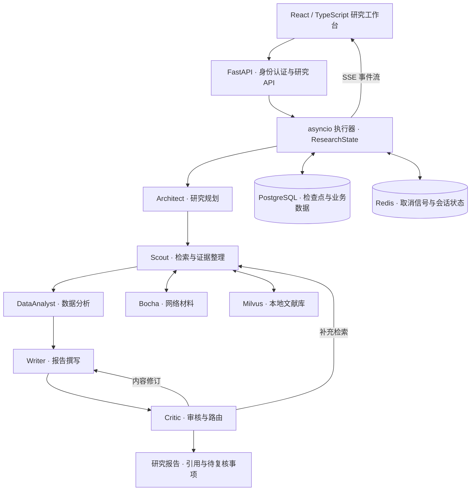

# LitTrace · 文献咨询助手

**多智能体文献调研与证据追溯平台：研究过程可见、报告出处可查、长任务可恢复。**

[](https://github.com/janeblackcc-gif/littrace/actions/workflows/ci.yml)


LitTrace 面向研究生开题和相关工作梳理。输入研究问题，选择方向和年份范围后，系统把联网搜索和本地文献库接在一起，由多个 Agent 分工完成研究规划、检索、分析、写作和审核，生成每条引用都能回查到原文片段的调研报告。

<p align="center">
  
  <br>
  <sub>Agent 记忆方向的一次真实运行：顶部是阶段进度，下方是抽取出的证据和来源。完整报告见 <a href="docs/examples/agent-memory/final_report.md">示例报告</a>。</sub>
</p>

## 亮点

- **多 Agent 编排**：asyncio 执行器串起规划、检索、分析、代码、写作、审核六个 Agent，共享 `ResearchState`。Critic 审完报告后决定补搜还是修订，执行器负责回退并限制迭代轮数。
- **检索与来源绑定**：网络检索接 Bocha，本地文献存 Milvus，检索并行执行；模型从结果中提出追踪查询，最多再深入两层。每条材料记录论文版本、日期和原文片段，报告引用写成 `[E:fact_xxx]`，可以回查到具体出处。
- **实时进度**：Agent 内部事件进入 `asyncio.Queue`，经 SSE 推到前端；前端处理流式分片、断流和取消。
- **断点恢复**：研究状态和界面状态以 JSONB 存入 PostgreSQL，中断后从上次完成的阶段继续。恢复前核对配置指纹和阶段位置，同一会话用 advisory lock 防止并发覆盖；报告与审核结果绑定哈希，修订后必须重新审核。
- **输出校验**：模型返回的计划依次经过 JSON 解析、业务 Schema 和研究方向字段规则检查，不合格时带错误信息重试，次数用完仍不合格就终止任务，坏数据不会流到下游 Agent。
- **离线回归测试**：回归脚本隔离网络和数据库，覆盖证据约束、方向校验、流生命周期等 214 项检查，每次推送由 GitHub Actions 自动运行。

## 系统架构



图中是研究主流程。代码 Agent（CodeWizard）负责代码与图表扩展，通过 `ENABLE_CODE_EXECUTION` 开关启用。

| 层次 | 技术 |
| --- | --- |
| 前端 | React 19、TypeScript、Vite、Ant Design、Valtio |
| 服务端 | Python 3.12、FastAPI、Pydantic、SQLAlchemy、asyncio |
| 模型 | DeepSeek、Qwen（OpenAI 兼容接口，按 Agent 角色分别配置） |
| 检索 | Bocha 搜索、Milvus 向量检索、网页正文提取 |
| 状态与存储 | PostgreSQL / JSONB、Redis、会话级 advisory lock |
| 测试 | 离线回归、真实服务故障注入、Playwright 浏览器验收 |

## 工程设计

**研究流程可控。** 执行器显式记录当前阶段、下一阶段和已完成阶段，把审核意见映射为补搜、修订或结束，并限制迭代次数，避免 Agent 之间无限循环。

**执行状态与内容质量分开。** `run_status` 记录任务执行到哪一步，`quality_status` 记录内容质量。页面据此分别展示完成、失败、取消和待复核，SSE 的结束标记只负责传输层。

**引用绑定到可检查的来源。** 材料保留来源身份、版本、日期和原文片段，报告中的每条引用都能回到原文。在定位之外，系统还会检查跨论文比较的条件和上下文是否一致，条件不可比的论断在报告中单独标注。

**权限与可靠性。** 研究、取消、检查点读取和恢复接口都校验登录身份和资源归属，知识库按用户和集合绑定。启动时校验必需配置，CORS 使用白名单。流式链路完整处理取消、断连、保活和异常终止，并配有故障注入脚本。

## 示例报告

三个内置研究方向各保留一次真实运行的导出，包括报告、证据边、来源审计和配置快照（密钥已脱敏）：

| 方向 | 研究问题 | 报告 |
| --- | --- | --- |
| RAG 与长上下文 | RAG 与长上下文在长文档问答上的边界：检索与长上下文方法的实证对比 | [查看](docs/examples/rag-long-context/final_report.md) |
| Agent 记忆 | 长程对话问答中，记忆的会话/轮次/事实粒度以及记忆压缩，效果依赖哪些条件？ | [查看](docs/examples/agent-memory/final_report.md) |
| LLM 评测与 Judge | 自动评审（LLM-as-judge）与人工判断的一致性取决于哪些标注与评审协议？ | [查看](docs/examples/llm-judge/final_report.md) |

报告会自动标出证据不足或条件不可比的论断，研究者可以据此重点复核。

## 快速开始

需要 Python 3.12、Node.js 20+、Docker Compose，以及可访问的 Milvus 2.5.x；模型调用和联网检索需要各自的 API Key。

```bash
git clone https://github.com/janeblackcc-gif/littrace.git
cd littrace
```

按 [本地运行指南](docs/QUICKSTART.md) 配置环境变量，启动 PostgreSQL / Redis、后端和前端。启动后访问：

| 入口 | 地址 |
| --- | --- |
| 研究工作台 | http://localhost:5173/login |
| API 文档 | http://localhost:8000/docs |

只想跑测试的话，不需要任何外部服务：

```bash
pip install -r backend/requirements.txt
python tools/acceptance/run_offline_acceptance.py tools/acceptance/verify_integrity_semantics.py
```

全部测试入口和真实服务验收脚本见 [验证说明](docs/VERIFICATION.md)。

## 代码导航

| 入口 | 职责 |
| --- | --- |
| [研究 API](backend/app/router/research_router.py) | 请求校验、权限、流式研究、取消与恢复 |
| [Agent 编排](backend/app/service/deep_research_v2/graph.py) | Agent 装配、配置绑定和研究入口 |
| [Agent 实现](backend/app/service/deep_research_v2/agents) | Architect、Scout、DataAnalyst、Writer、Critic、CodeWizard |
| [阶段执行器](backend/app/service/research_runtime.py) | 阶段调度、异步事件、审核路由与终态提交 |
| [状态与证据约束](backend/app/service/research_integrity.py) | 状态版本、证据合同、质量状态与恢复校验 |
| [检查点并发控制](backend/app/service/checkpoint_guard.py) | 会话锁、保活与持久化保护 |
| [来源与材料处理](backend/app/service/research_sources.py) | 来源身份、版本日期、正文与证据材料 |
| [前端](frontend/src) | 研究工作台、SSE 消费与状态展示 |
| [验收工具](tools/acceptance) | 离线回归、故障注入、运行产物导出 |

## 后续方向

- **条件匹配**：显式区分任务、模型、上下文预算和评测指标，让跨论文的结论比较只在可比条件下进行。
- **原子论断拆分**：把复合结论拆成保留限定词的子命题，逐条绑定证据。
- **支持关系判断**：结合实验结果与实验条件，自动区分引用是支持、反驳还是仅相关。
- **评测集建设**：构建带原文范围和人工标注的开发集与测试集，量化上述改进的效果。

具体假设和验证方法见 [ROADMAP](docs/ROADMAP.md)。
